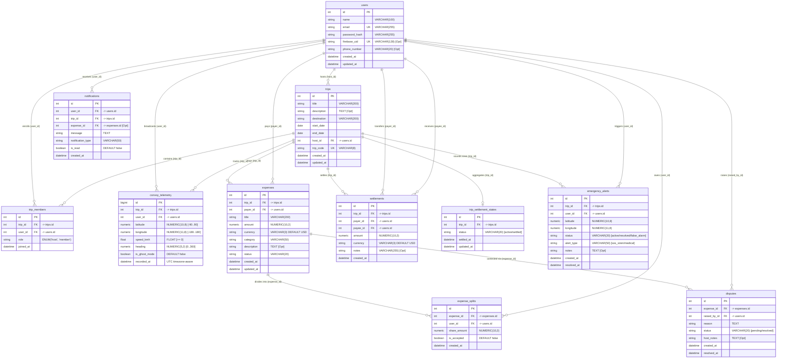
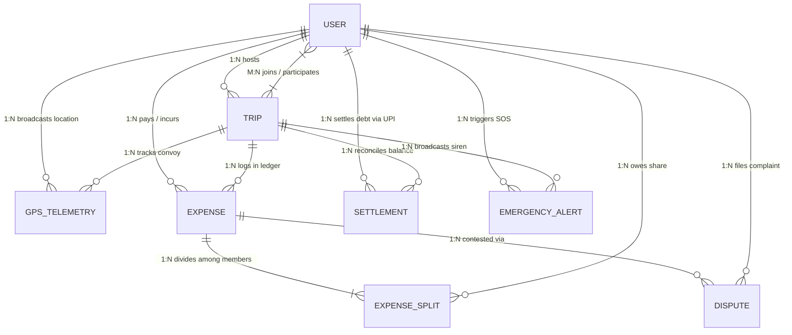
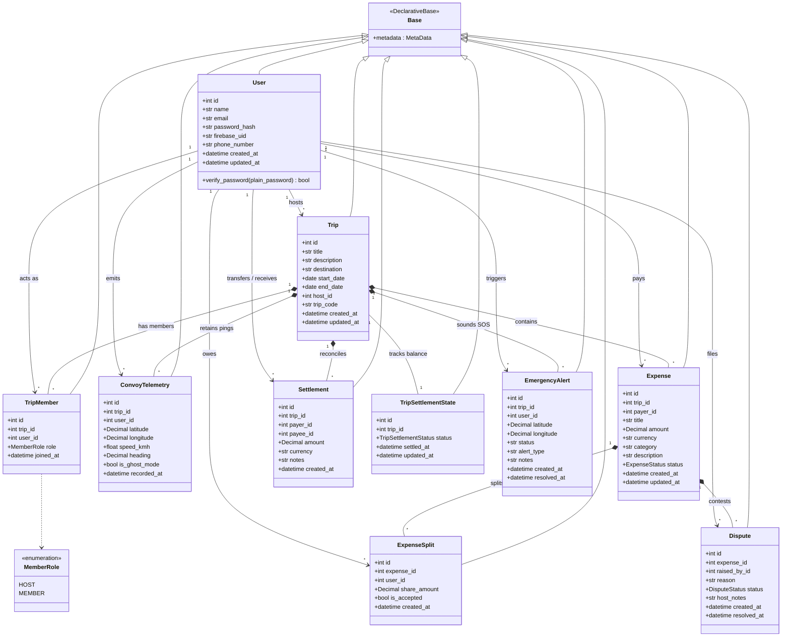
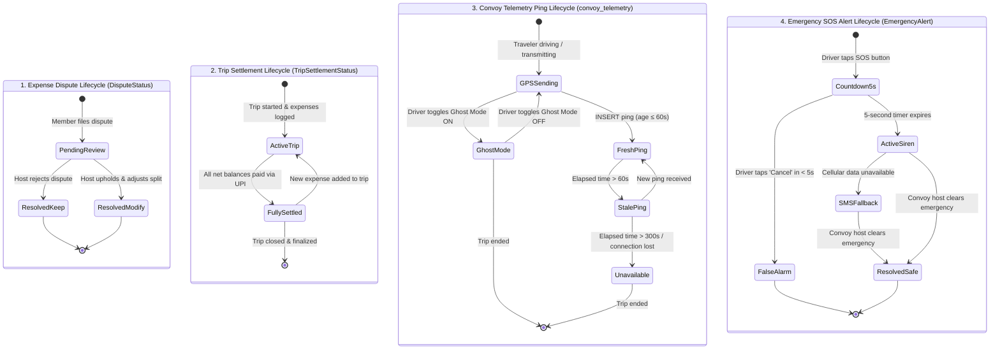
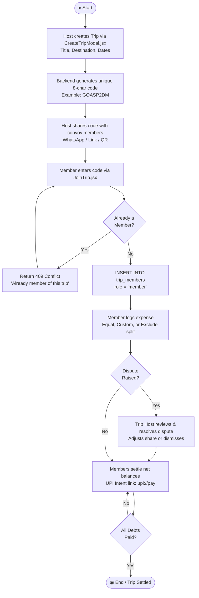

# ConvoySync Architecture & Design Diagrams (IT-314)

This directory contains the standalone architecture, database, and design diagrams for **ConvoySync** (Group 8, IT-314 Software Engineering).

All diagrams are available in three formats:
1. **Interactive Mermaid Diagrams** (rendered natively in this README on GitHub)
2. **Editable Draw.io Source Files** ([`*.drawio`](./))
3. **High-Resolution PNG Exports** ([`images/*.png`](images/))

---

## Quick Navigation

- [1. Relational Schema (Physical Data Model)](#1-relational-schema-physical-data-model)
- [2. Conceptual ERD (Domain Model)](#2-conceptual-erd-domain-model)
- [3. UML Class Diagram (SQLAlchemy ORM)](#3-uml-class-diagram-sqlalchemy-orm)
- [4. UML Sequence Diagram (Auth, Telemetry & SOS)](#4-uml-sequence-diagram-auth-telemetry--sos)
- [5. UML State Diagram (Entity Lifecycles)](#5-uml-state-diagram-entity-lifecycles)
- [6. UML Activity Diagram (Trip & Expense Workflow)](#6-uml-activity-diagram-trip--expense-workflow)

---

## 1. Relational Schema (Physical Data Model)

> **File:** [`relational_schema.drawio`](relational_schema.drawio) | [`images/relational_schema.png`](images/relational_schema.png)  
> **Description:** Complete physical schema across PostgreSQL / Neon, showing all 10 application tables, primary keys, foreign keys (`ON DELETE CASCADE`), constraints, and relationships.



---

## 2. Conceptual ERD (Domain Model)

> **File:** [`conceptual_erd.drawio`](conceptual_erd.drawio) | [`images/conceptual_erd.png`](images/conceptual_erd.png)  
> **Description:** High-level Entity-Relationship model capturing key business domains, roles, cardinality relationships, and data flows.



---

## 3. UML Class Diagram (SQLAlchemy ORM)

> **File:** [`uml_class_diagram.drawio`](uml_class_diagram.drawio) | [`images/uml_class_diagram.png`](images/uml_class_diagram.png)  
> **Description:** Object-Relational Mapping (ORM) architecture showing SQLAlchemy models, data attributes, enums, methods, and parent-child navigation.



---

## 4. UML Sequence Diagram (Auth, Telemetry & SOS)

> **File:** [`uml_sequence_diagram.drawio`](uml_sequence_diagram.drawio) | [`images/uml_sequence_diagram.png`](images/uml_sequence_diagram.png)  
> **Description:** Complete runtime message flow across 3 phases: adaptive GPS telemetry ingestion, convoy location polling with lag detection, and emergency SOS siren with offline SMS fallback.

```mermaid
sequenceDiagram
    autonumber
    actor Driver as Traveler / Driver
    participant App as React Frontend (ConvoyMap)
    participant API as FastAPI Backend (Router)
    participant Auth as Auth Dependency (JWT)
    participant GIS as GIS Engine (Haversine)
    participant DB as PostgreSQL (Neon DB)
    actor Convoy as Convoy Members

    %% ========================================================
    %% PHASE 1: GPS ADAPTIVE INGESTION
    %% ========================================================
    rect rgb(239, 246, 255)
    Note over Driver,DB: PHASE 1: Velocity-Adaptive GPS Ingestion (5s highway / 15s city / 30s stop)
    Driver->>App: GPS sensor ping (lat, lon, speed, heading)
    App->>GIS: Calculate adaptive interval (speed > 40 km/h -> 5s)
    GIS-->>App: Return polling schedule (5000ms)
    App->>API: POST /trips/{id}/telemetry (lat, lon, speed, heading, is_ghost_mode) [Bearer Token]
    API->>Auth: Verify JWT & extract current_user
    Auth-->>API: User verified (id, email)
    API->>DB: Query trip_members (SELECT 1 WHERE trip_id = ? AND user_id = ?)
    alt Not Active Member
        API-->>App: HTTP 403 Forbidden ("Must be active trip member")
    else Member Verified
        API->>DB: INSERT INTO convoy_telemetry VALUES (...); COMMIT
        DB-->>API: Record stored (id, recorded_at)
        API-->>App: HTTP 201 Created (coords masked if is_ghost_mode=True)
    end
    end

    %% ========================================================
    %% PHASE 2: CONVOY POLLING & LAG MONITORING
    %% ========================================================
    rect rgb(240, 253, 250)
    Note over Driver,Convoy: PHASE 2: Convoy Location Polling & Distance Lag Evaluation
    App->>API: GET /trips/{id}/convoy/locations [Bearer Token]
    API->>DB: B-tree scan: ROW_NUMBER() OVER (PARTITION BY user_id ORDER BY recorded_at DESC)
    DB-->>API: Enrolled members + latest telemetry ping
    Note over API: Classify Freshness:<br/>≤ 60s: 'fresh'<br/>60s–300s: 'stale'<br/>> 300s: 'unavailable'
    Note over API: Privacy filter: if is_ghost_mode == True<br/>-> status='hidden', lat=null, lon=null
    API-->>App: HTTP 200 OK [{user_id, name, lat, lon, speed_kmh, status, is_ghost_mode}, ...]
    App->>GIS: Forward positions to GIS Engine
    Note over GIS: Compute Convoy Centroid<br/>Haversine distance lag > 2.0 km?
    GIS-->>App: Return lag result {has_lag: true, lagging_members: [...]}
    App->>Driver: Render Leaflet map pins + Amber Lag Alert banner
    App-->>Convoy: Lag notification rendered across convoy members
    end

    %% ========================================================
    %% PHASE 3: EMERGENCY SOS SIREN
    %% ========================================================
    rect rgb(254, 242, 242)
    Note over Driver,Convoy: PHASE 3: Emergency SOS Siren with 5s Abort Countdown & SMS Fallback
    Driver->>App: Tap One-Touch SOS Button
    Note over App: Start 5-second countdown siren audio
    alt Cancelled within 5 seconds
        Driver->>App: Tap 'Cancel / False Alarm'
        Note over App: Abort broadcast, dismiss siren
    else Timer Expires (5 seconds)
        App->>API: POST /trips/{id}/sos (lat, lon, alert_type='sos_siren')
        API->>DB: INSERT INTO emergency_alerts (trip_id, user_id, status='active'); COMMIT
        DB-->>API: Alert created
        App->>Driver: Launch offline SMS fallback (sms:+91...?body=SOS_GPS_LAT_LON)
        API-->>Convoy: High-priority distress siren & flashing red banner broadcast to all members
    end
    end
```

---

## 5. UML State Diagram (Entity Lifecycles)

> **File:** [`uml_state_diagram.drawio`](uml_state_diagram.drawio) | [`images/uml_state_diagram.png`](images/uml_state_diagram.png)  
> **Description:** Finite state machines covering the lifecycles of Expense Disputes, Trip Settlements, Convoy Telemetry Pings, and Emergency SOS Alerts.



---

## 6. UML Activity Diagram (Trip & Expense Workflow)

> **File:** [`uml_activity_diagram.drawio`](uml_activity_diagram.drawio) | [`images/uml_activity_diagram.png`](images/uml_activity_diagram.png)  
> **Description:** End-to-end user workflow: Host trip creation, unique 8-character trip code generation, duplicate-checked joining, expense logging, dispute resolution, and final UPI settlement.



---

## Technical Summary Table for Evaluators

| Diagram Type | UML / Modeling Standard | Core Purpose | DB / System Anchor |
| :--- | :--- | :--- | :--- |
| **Relational Schema** | Physical Crow's Foot Schema | Table structures, column data types, Foreign Keys, cascading rules, and composite indexes. | Neon PostgreSQL Database |
| **Conceptual ERD** | Domain Entity-Relationship | Business entities, relationships, cardinality mapping (`1:N`, `M:N`). | Domain-Driven Design (DDD) |
| **UML Class Diagram** | UML 2.5 Class Diagram | SQLAlchemy ORM declarative models, attributes, enums, methods, and class inheritance. | `backend/app/models/` |
| **UML Sequence Diagram** | UML 2.5 Sequence Diagram | Chronological messaging for GPS adaptive capture, JWT auth, convoy lag detection, and SOS alerts. | FastAPI Routers & WebSockets |
| **UML State Diagram** | UML 2.5 State Machine | State transitions and lifecycles for Disputes, Settlements, Telemetry Freshness, and SOS Siren. | Enum fields & Status flags |
| **UML Activity Diagram** | UML 2.5 Activity Diagram | Process workflow for Trip Creation, Invitation, Expense Logging, Dispute Review, and UPI Settlements. | End-to-End User Experience |
