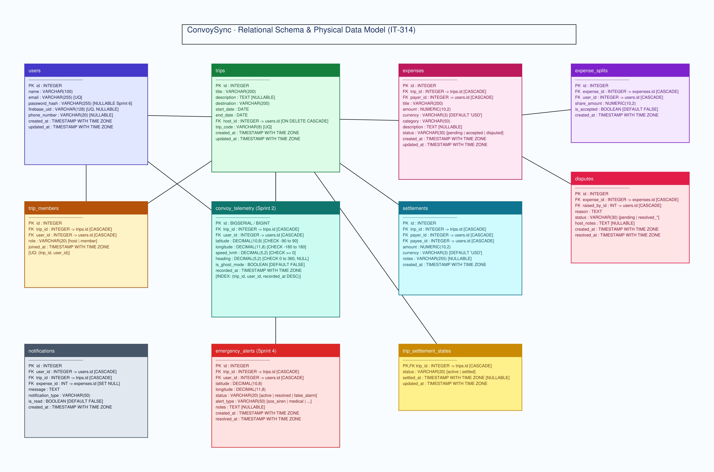
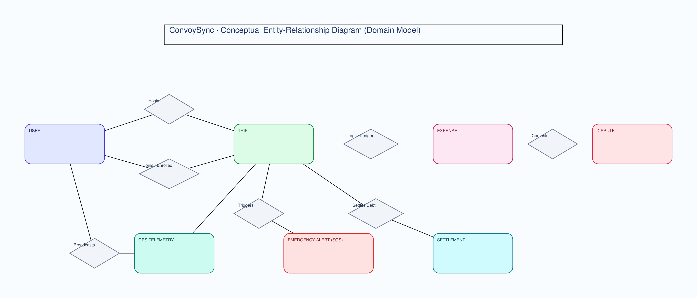
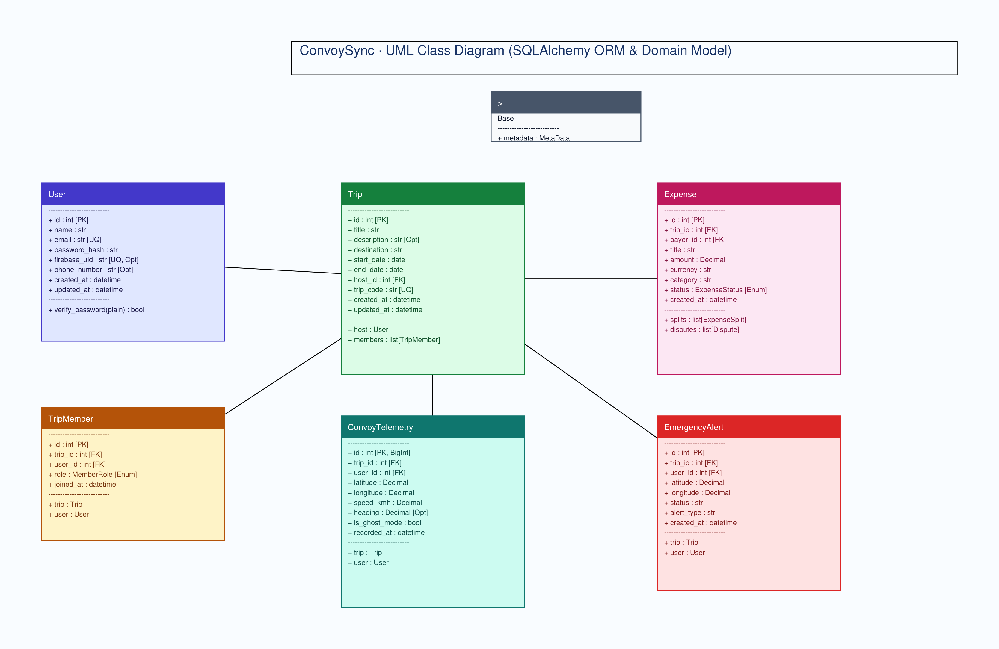
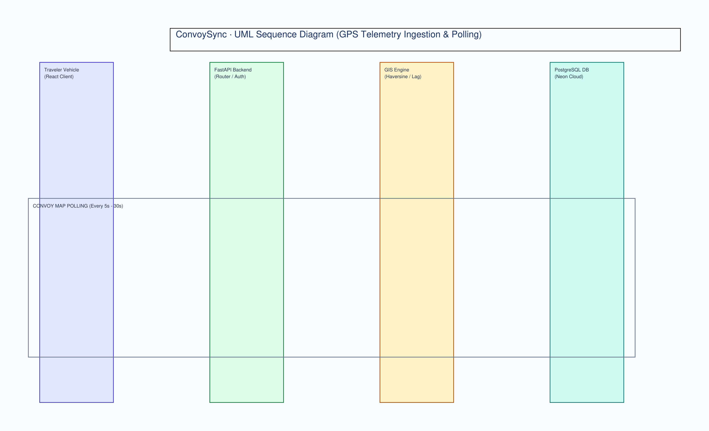
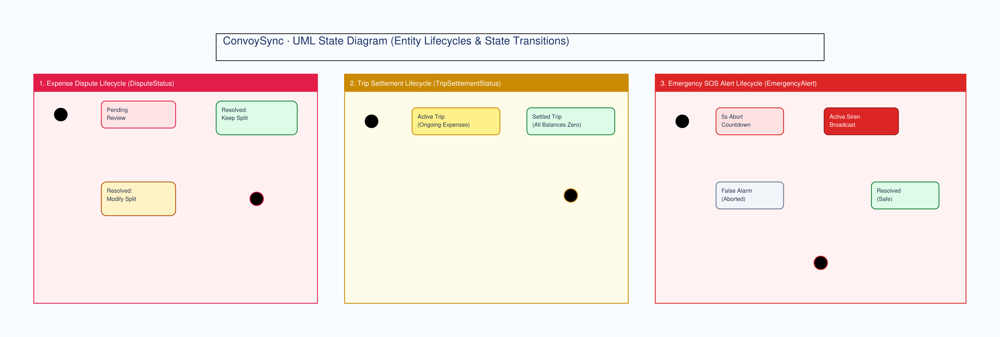
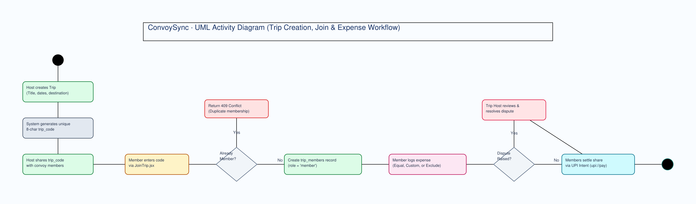

# ConvoySync Architecture Diagrams

This directory contains standalone architecture and design diagrams for ConvoySync (IT-314 Software Engineering, Group 8).

Available in both editable Draw.io format (`.drawio`) and high-resolution raster image format (`.png` in [`images/`](images/)).

---

## Diagram Directory & Visual Previews

| Diagram Type | Draw.io Source | High-Res PNG Image | Description |
| :--- | :--- | :--- | :--- |
| **Conceptual ERD** | [`conceptual_erd.drawio`](conceptual_erd.drawio) | [`images/conceptual_erd.png`](images/conceptual_erd.png) | Domain-level Entity-Relationship Model showing business entities (`USER`, `TRIP`, `EXPENSE`, `TELEMETRY`, `SOS`) and relationships. |
| **Relational Schema** | [`relational_schema.drawio`](relational_schema.drawio) | [`images/relational_schema.png`](images/relational_schema.png) | Physical database schema showing all 10 tables, primary keys, foreign keys (`ON DELETE CASCADE`), data types, and composite indexes. |
| **UML Class Diagram** | [`uml_class_diagram.drawio`](uml_class_diagram.drawio) | [`images/uml_class_diagram.png`](images/uml_class_diagram.png) | ORM code structure showing SQLAlchemy declarative models, attributes, types, and associations. |
| **UML Sequence Diagram** | [`uml_sequence_diagram.drawio`](uml_sequence_diagram.drawio) | [`images/uml_sequence_diagram.png`](images/uml_sequence_diagram.png) | Chronological messaging flow for GPS Telemetry ingestion and velocity-adaptive map polling. |
| **UML State Diagram** | [`uml_state_diagram.drawio`](uml_state_diagram.drawio) | [`images/uml_state_diagram.png`](images/uml_state_diagram.png) | Entity lifecycles and state transitions for Expense Disputes, Trip Settlements, and Emergency SOS Siren. |
| **UML Activity Diagram** | [`uml_activity_diagram.drawio`](uml_activity_diagram.drawio) | [`images/uml_activity_diagram.png`](images/uml_activity_diagram.png) | End-to-end user workflow: Trip creation, duplicate-safe joining, expense splitting, and UPI settlement. |

---

## Previews

### 1. Relational Schema (Physical Data Model)

### 2. Conceptual ERD

### 3. UML Class Diagram (SQLAlchemy ORM)

### 4. UML Sequence Diagram (Telemetry Ingestion & Map Polling)

### 5. UML State Diagram (Entity Lifecycles)

### 6. UML Activity Diagram (Trip Creation & Expense Flow)

